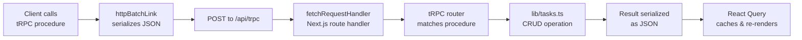

# Architecture

## System Overview

The task manager is a single-page Next.js v15 application with a typed RPC (tRPC) backend. The frontend and backend share TypeScript types, so the client knows the server's procedure signatures at compile time.

```mermaid
graph TD
    subgraph Browser["Browser (Client)"]
        direction TB
        page[page.tsx<br/>Server Component (Task List)]
        createPage[/tasks/new<br/>Client Component]
        editPage[/tasks/[id]/edit<br/>Client Component]
        trpcClient[tRPC Client<br/>createTRPCReact + QueryClient]
    end

    subgraph Server["Next.js App Router (Server)"]
        direction TB
        route[app/api/trpc/[trpc]/route.ts<br/>fetchRequestHandler]
        router[server/trpc/router.ts<br/>t.initTRPC().router]
        procedures[Procedures<br/>taskList • taskCreate<br/>taskUpdate • taskDelete]
        store[lib/tasks.ts<br/>In-memory Task[] store<br/>addTask/list/update/delete]
        types[types/task.ts<br/>Task interface<br/>shared by client & server]
    end

    page -->|uses| trpcClient
    createPage -->|uses| trpcClient
    editPage -->|uses| trpcClient
    trpcClient -->|HTTP POST JSON| route
    route --> router
    router --> procedures
    procedures --> store
    store -.-> types
    router -.-> types
```

## Data Flow

### Client → Server (tRPC Query/Mutation)



1. Client calls a tRPC procedure (e.g., `trpc.taskList.query()`)
2. `httpBatchLink` serializes the call as JSON and POSTs to `/api/trpc`
3. Next.js route handler invokes `fetchRequestHandler` from `@trpc/server/adapters/fetch`
4. tRPC routes the call to the matching procedure in `server/trpc/router.ts`
5. Procedure calls a function in `lib/tasks.ts` (the in-memory store)
6. Result is serialized back to the client as JSON
7. React Query caches the result and re-renders the UI

### tRPC Procedures

| Procedure | Type | Input | Output | Description |
|-----------|------|-------|--------|-------------|
| `hello` | Query | None | `string` | Health check, returns `"hello"` |
| `taskList` | Query | None | `Task[]` | Returns all tasks sorted newest first |
| `taskCreate` | Mutation | `{ title: string, description?: string }` | `Task` | Creates a new task; title is required |
| `taskUpdate` | Mutation | `{ id: string, title?: string, description?: string }` | `Task` | Updates existing task; `id` and `createdAt` are immutable |
| `taskDelete` | Mutation | `{ id: string }` | `boolean` | Removes a task; returns `true` on success |

### Server Component Boundary

- `app/layout.tsx` wraps all pages with `TrpcProvider` (a Client Component)
- `app/page.tsx` is a Server Component that renders the task list server-side
- `app/tasks/new/page.tsx` is a Client Component (`'use client'`) for creating tasks
- `app/tasks/[id]/edit/page.tsx` is a Client Component (`'use client'`) for editing tasks
- tRPC procedures run on the server; the client never accesses `lib/tasks.ts` directly

## Component Boundaries

| Layer | Responsibility | Can access store? | Can access browser APIs? |
|-------|---------------|-------------------|--------------------------|
| `app/page.tsx` | SSR task list rendering | No (via tRPC only) | No (Server Component) |
| `app/tasks/new/page.tsx` | Create task form | No (via tRPC only) | Yes |
| `app/tasks/[id]/edit/page.tsx` | Edit task form | No (via tRPC only) | Yes |
| `app/_trpc/client.ts` | tRPC client configuration | No | Yes |
| `app/_trpc/provider.tsx` | React Query + tRPC context | No | Yes |
| `app/api/trpc/[trpc]/route.ts` | HTTP request adapter | No | No (server only) |
| `server/trpc/router.ts` | Procedure definitions | Yes (via lib/tasks.ts) | No |
| `lib/tasks.ts` | In-memory CRUD operations | Yes (owns the array) | No |
| `types/task.ts` | Type definitions | N/A | N/A |

## Key Design Properties

- **Single source of truth for types:** `types/task.ts` is imported by both `lib/tasks.ts` and `server/trpc/router.ts`. The client infers procedure types from `AppRouter` exported by the router.
- **No direct store access from client:** The browser cannot read or write `lib/tasks.ts`. All data mutations go through tRPC procedures.
- **Stateless route handler:** `createContext` returns an empty object `{}`; the in-memory store is module-level state in `lib/tasks.ts`, not request-scoped.
- **Partial updates:** `taskUpdate` accepts only the fields to change (`title` and/or `description`); `id` and `createdAt` are never modified.